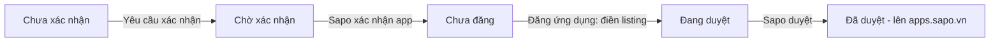

# Quy trình đăng app lên Kho ứng dụng Sapo và nội dung listing - F1GENZ Reviews

Nguồn đối chiếu: app đã duyệt `3385` (Tối ưu PageSpeed Insight by F1GenZ) trên `developers.sapo.vn`, đọc trực tiếp bằng phiên partner F1GENZ ngày 2026-11-10. App cần đăng: `3833` (F1GENZ Reviews - Đánh giá sản phẩm). Không ghi API key hay secret trong file này.

## 1. Vòng đời trạng thái (đo từ 5 app của tài khoản partner)

| Trạng thái trên danh sách | App | Nút ở góc phải trang "Chỉnh sửa ứng dụng" |
|---|---|---|
| Chưa xác nhận | 3880 Sapo CLI | "Yêu cầu xác nhận" (`sendVerified(this)`) |
| Chờ xác nhận | **3833 Reviews** | "Yêu cầu xác nhận" bị mờ; `/publish/3833` tự chuyển về trang chi tiết |
| Chưa đăng | 3580 Chuyển đổi tiền tệ | "Đăng ứng dụng" (`/publish/<id>`) |
| Đang duyệt | 3584 Dịch vụ phát triển tính năng | (đã gửi listing) |
| Đã duyệt | 3385 PageSpeed | "Đăng ứng dụng" |

Suy ra [INFERENCE: thứ tự này chưa có tài liệu Sapo xác nhận, chỉ ghép từ 5 trạng thái quan sát được]:



Vị trí của 3833 ngày 2026-11-11: đã sang bước C ("Chưa đăng"), form `/publish/3833` mở được và đã được điền đủ qua AntiFan (mục 7), chưa bấm "Đăng ứng dụng". Trang công khai `apps.sapo.vn/f1genz-reviews-danh-gia-san-pham` trả HTTP 200 nhưng chưa có nội dung listing.

Sapo công bố thời gian xét duyệt hồ sơ đối tác là 5-7 ngày làm việc (`sapo.vn/partner.html`); không có tài liệu công khai về tiêu chí duyệt từng app hay thời gian duyệt listing.

## 2. Form "Đăng ứng dụng lên chợ ứng dụng" (đọc từ `/publish/3385`)

| Trường (name) | Ghi chú đo được | Giá trị đề xuất cho Reviews |
|---|---|---|
| `Category` | Marketing và CSKH, Hỗ trợ bán hàng, Vận chuyển, Hỗ trợ vận hành cửa hàng, Quản trị website, Tài chính - Thanh toán | **Hỗ trợ bán hàng** (chủ app đã chốt) |
| `ReviewNotificationEmail` | mặc định email tài khoản | `support@f1genz.com` |
| `appBanner` | 310x100 px, jpg/png/gif | `docs/listing-assets/banner-310x100.png` |
| `appFeatureBanner` | 970x380 px, jpg/png/gif | `docs/listing-assets/feature-banner-970x380.png` |
| `YoutubeUrl` | tuỳ chọn; validate regex `^https?://<host>.youtube.com/embed/...`, nên chỉ nhận dạng `https://www.youtube.com/embed/<id>`; trang công khai hiện không render link này | video có sẵn `E:/Work/scratch/app-promo-eval/multiform-ad/out/review-sapo-ad-v2.mp4` (1080x1920, 38 giây) nhưng chưa có trên YouTube |
| `ShortDescription` | tối đa **140 ký tự** (`data-val-maxlength-max`); thẻ app hiện khoảng 94 ký tự đầu | mục 3.1 (128 ký tự) |
| `FullDescription` | CKEditor 4.4.7; bộ lọc ACF phía client xoá `style` trên `div`/`h2`/`span`/`td` và xoá `iframe`, nhưng server lưu HTML thô (listing 3385 công khai còn nguyên inline style) | `docs/listing-assets/full-description.html` |
| `MetaTitle`, `MetaDescription` | mỗi trường tối đa 150 ký tự | mục 3.3 |
| `SellingPoint1..3` | tối đa 255 ký tự; không hiện trên trang công khai `apps.sapo.vn` | mục 3.4 |
| Ảnh chụp màn hình | form có đúng 4 ô `appScreenshots`; 3385 dùng ảnh 800x455 | 4 ảnh 1600x910 (cùng tỉ lệ) trong `docs/listing-assets/` (mục 4) |
| `PricingType` | Miễn phí / Thanh toán một lần (3385: 9.000.000đ) / Thanh toán theo kỳ hạn (`Period` 1-36 + `Price`) | **Thanh toán theo kỳ hạn**: `Period` = 1, `Price` = 119000 (chủ app đã chốt 119.000đ/tháng) |
| `TrialDays` | 3385: 0 | 0 |

Trang "Chỉnh sửa ứng dụng" của 3833 đã đúng: Embedded = Bật, Application URL = `https://api-sapo-reviews.f1genz.dev/api/oauth/install/callback`, Preference Url và Support Url để trống (placeholder `localhost`, không lưu). Không đổi gì ở đó trước khi Sapo xác nhận.

Hiển thị công khai (đọc từ `apps.sapo.vn/toi-uu-pagespeed-insight-by-f1genz`): tên nhà phát triển, điện thoại và email lấy từ hồ sơ tài khoản partner (Công Ty TNHH KTCN F1GENZ, 0932093794), không nhập trong form. Kiểm tra hồ sơ trước khi đăng, vì thông tin này hiện ra cho merchant.

Khảo sát 65 listing công khai (2026-11-11): `plans/reports/sapo-listing-benchmark.md`. Ô ảnh chụp trên trang công khai là 822x477, mỗi app có tối đa 4 ảnh. Trang `apps.sapo.vn/f1genz-reviews-danh-gia-san-pham` đang hiện khung "Lưu ý: Ứng dụng chỉ hỗ trợ các cửa hàng sử dụng Sapo OmniAI…" vì trường "Phiên bản hỗ trợ" (không có trong form) đang là Sapo OmniAI.

## 3. Nội dung sẵn để dán

Mọi tính năng dưới đây có trong code của repo (`client/src/pages/settings`, `client/src/components/DataTools.jsx`, `storefront/`, `docs/sapo-listing-dossier.md`). Hai giới hạn thật được ghi thẳng vào mô tả để tránh review bị trả vì mô tả sai: widget cài bằng snippet vào theme (app không xin scope theme), và nhãn "đã mua hàng" chỉ có với đơn phát sinh sau khi cài app.

### 3.1 Mô tả ngắn (`ShortDescription`)

```text
Thu thập đánh giá có ảnh, video và hỏi đáp cho từng sản phẩm, hiển thị đẹp trên website Sapo và hỗ trợ sao đánh giá trên Google.
```

### 3.2 Mô tả đầy đủ (`FullDescription`)

Nguồn: `docs/listing-assets/full-description.html` (dán vào chế độ mã nguồn). Bố cục: khối hero nền gradient, lưới 6 thẻ tính năng phía storefront, danh sách tính năng quản trị, 3 thẻ "Phù hợp với", 4 bước cài đặt có số tròn, quyền truy cập và dữ liệu, thẻ giá 119.000đ/tháng kèm email hỗ trợ. Số liệu lấy từ code: tối đa 5 tệp mỗi đánh giá (`storefront/snippets/f1genz-storefront.js` `MAX_MEDIA_FILES`), ảnh JPG/PNG/WebP tối đa 5 MB, video MP4 tối đa 2 MB (`worker/src/core/media/media.service.ts`). Dữ liệu lưu trong một Durable Object chung (`worker/src/index.ts` `idFromName('global')`), nên mô tả không nói "tách riêng từng cửa hàng".

Khi dán lại bằng tay, chế độ mã nguồn của editor vẫn chạy bộ lọc ACF và làm mất style. Bản điền qua AntiFan gọi `CKEDITOR.instances.FullDescription.filter.disable()` trước `setData`, rồi đọc lại `getData()`: còn đủ 74/74 thuộc tính `style`.

### 3.3 Thẻ meta

| Trường | Nội dung | Độ dài |
|---|---|---|
| `MetaTitle` | `F1GENZ Reviews - Đánh giá và hỏi đáp sản phẩm cho website Sapo` | 61 ký tự |
| `MetaDescription` | `Thu thập đánh giá, hỏi đáp có ảnh video, xuất sao đánh giá lên Google cho website Sapo. Duyệt linh hoạt, tuỳ chỉnh giao diện, nhập xuất CSV.` | 141 ký tự |

### 3.4 Ba lợi điểm

| Trường | Nội dung |
|---|---|
| `SellingPoint1` | Tăng niềm tin khách hàng |
| `SellingPoint2` | Sao đánh giá trên Google |
| `SellingPoint3` | Quản lý đánh giá dễ dàng |

## 4. Hình ảnh (đã tạo, trong `docs/listing-assets/`)

| Trường form | File | Nội dung |
|---|---|---|
| `appBanner` | `banner-310x100.png` | 310x100 |
| `appFeatureBanner` | `feature-banner-970x380.png` | 970x380 |
| Ảnh chụp 1 | `screenshot-1-widget-trang-san-pham-1600x910.png` | Widget trên trang sản phẩm thật (Mt. Lassen Trout, 7 đánh giá, 4.4) |
| Ảnh chụp 2 | `screenshot-2-tong-quan-1600x910.png` | Bảng tổng quan admin |
| Ảnh chụp 3 | `screenshot-3-duyet-phan-hoi-1600x910.png` | Danh sách đánh giá, lọc trạng thái, phản hồi |
| Ảnh chụp 4 | `screenshot-4-tuy-chinh-giao-dien-1600x910.png` | Cấu hình Giao diện và xem trước storefront |

Bốn ảnh chụp app thật trên shop demo `f1genz-seafoods.mysapo.net` (205 đánh giá mẫu, 47 sản phẩm) ở viewport 1440x860, DPR 2, rồi đặt vào khung trình duyệt trên nền gradient kèm tiêu đề, cùng bộ màu navy/vàng với banner. Ảnh 1 chụp đoạn đầu danh sách, không có nhãn "Đã mua hàng". Sapo không công bố kích thước ảnh chụp; 1600x910 giữ tỉ lệ 800x455 của 3385. Thanh bên admin ghi "F1GENZ Review" (không có "s").

## 5. Quyết định đã chốt và việc còn mở

Đã chốt (chủ app, 2026-11-10): giá 119.000đ/tháng (`PricingType` = kỳ hạn, `Period` = 1, dùng thử 0 ngày), danh mục Hỗ trợ bán hàng, hình ảnh do tôi tạo.

Còn mở, cần chủ app quyết định trước khi bấm "Đăng ứng dụng":

1. **Scope `write_content`.** `worker/wrangler.jsonc` (production) xin `read_products,write_products,read_orders,write_content`, còn `.env.example`, `docs/env-contract.md`, `docs/deploy-sapo.md` và `docs/security-checklist.md` vẫn ghi 3 scope đầu. Tài liệu Sapo (`support.sapo.vn/oauth`) mô tả `write_content` là quyền với Article, Blog, Comment, Page, Redirect; code không gọi tài nguyên nào trong số đó (chỉ gọi `/products/{id}/metafields.json` và `/metafields.json`). Commit duy nhất thêm scope này là bản chuyển sang Worker, không kèm lý do. Mô tả 3.2 hiện giải trình là "ghi metafield cấp cửa hàng" [INFERENCE: chưa thử]. Hai lựa chọn: (a) bỏ `write_content` khỏi `wrangler.jsonc`, deploy lại, cài lại trên shop demo và kiểm tra metafield `f1genz.config` vẫn ghi được; (b) giữ và giữ nguyên giải trình, nhưng khi Sapo hỏi lý do cần chứng minh bằng một lần cài thử. Tôi chưa đổi gì trên production.
2. **Thu phí.** Giá 119.000đ/tháng đặt ở portal, nhưng app không có code billing hay kiểm tra gói/hạn thanh toán (`featuresUnlocked` luôn `true` khi cài), và Sapo không công bố topic hay API charge: mọi shop đã cài đều dùng đủ tính năng; việc thu tiền do Sapo xử lý theo form và cơ chế đó chưa được xác minh. Chưa biết: app có bị gỡ cài tự động (webhook `app/uninstalled`) khi hết hạn hay không. Hỏi Sapo, hoặc đo trên một lần cài thật có tính phí.
3. **Cam kết trong mô tả.** Mô tả 3.2 chỉ nêu những gì code đã làm. Không thêm "tự động chèn widget vào theme" khi chưa có scope theme.
4. **Video demo.** `review-sapo-ad-v2.mp4` (dọc 9:16, 38 giây) chưa có trên YouTube. Tài khoản YouTube đang đăng nhập trong AntiFan là kênh "Tường Vy", không phải kênh F1GENZ, nên `YoutubeUrl` đang để trống. Chủ app upload lên kênh F1GENZ rồi dán link vào form trước khi gửi.
5. **Ảnh chụp và nhãn "Đã mua hàng".** Đã xử lý ngày 2026-11-11: bộ ảnh mới không hiện nhãn này. 205 đánh giá trên shop demo vẫn là dữ liệu mẫu tạo qua API admin.

## 6. Việc cần kiểm trước khi bấm "Đăng ứng dụng"

1. Hồ sơ tài khoản partner: tên công ty, điện thoại, email đúng (hiện ra công khai).
2. Chính sách bảo mật và điều khoản: `docs/sapo-listing-dossier.md` mục 8 liệt kê URL chính sách bảo mật chưa có; form đăng của 3385 không có trường này, nhưng Sapo có thể hỏi khi duyệt.
3. Chạy lại `npm run verify` và các suite e2e, lấy số liệu mới nhất nếu Sapo hỏi chứng cứ kiểm thử.

## 7. Trạng thái điền form (2026-11-11, tab AntiFan `/publish/3833`)

Đã điền và đọc lại trong DOM: Danh mục = Hỗ trợ bán hàng, email = `support@f1genz.com`, mô tả ngắn (128 ký tự), mô tả đầy đủ (11.014 ký tự sau khi đã đối chiếu từng khẳng định với code, còn đủ 74/74 `style`), meta title và meta description, 3 lợi điểm, 2 banner, 4 ảnh chụp, Thanh toán theo kỳ hạn với `Period` = 1, `Price` = 119000, dùng thử 0 ngày. Validate phía client của form (`jQuery(form).valid()`) trả `true`, không có lỗi. `YoutubeUrl` để trống (mục 5.4). Form chưa được lưu: tải lại tab là mất dữ liệu đã điền và phải điền lại. "Hình thức thanh toán chỉ được lựa chọn trong lần đầu gửi yêu cầu đăng ứng dụng", nên kiểm lại giá trước khi bấm "Đăng ứng dụng".
